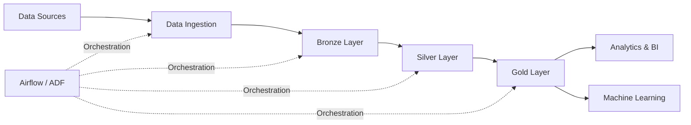

<h1 align="center">Igor Machado Ferrari</h1>

<h3 align="center">
  Data Engineer | Data Architecture | Cloud & Automation
</h3>

  
  
  

---

## About Me

I'm a Data Engineer passionate about building scalable, reliable 
and efficient data solutions.

My interests include data architecture, distributed computing, 
cloud infrastructure, machine learning, automation and software 
engineering.

- Building and maintaining scalable data pipelines.
- Developing ETL and ELT solutions.
- Designing Lakehouse and Medallion architectures.
- Working with distributed data processing.
- Integrating APIs, databases and streaming platforms.
- Exploring Machine Learning and Data Science applications.
- Developing and maintaining self-hosted infrastructure.
- Continuously learning about system design and new technologies.

---

## Tech Stack

### Programming Languages

### Data Engineering

### Data Science & Machine Learning

### Cloud & DevOps

### Databases

### Analytics & Business Intelligence

### Python Libraries & Integrations

### Infrastructure & Networking

### Development Tools

---

## Technical Skills

### Data Architecture

- Medallion Architecture (Bronze, Silver and Gold)
- Data Lake
- Data Lakehouse
- Data Warehouse
- Dimensional Modeling
- Data Integration
- Data Quality
- Data Governance

### Data Processing

- ETL and ELT Pipelines
- Batch Processing
- Stream Processing
- Distributed Computing
- Change Data Capture (CDC)
- Incremental Data Loading
- Full Data Loading
- Data Transformation and Optimization
- Workflow Orchestration

### Data Science & Analytics

- Exploratory Data Analysis (EDA)
- Statistical Analysis
- Data Visualization
- Feature Engineering
- Supervised Learning
- Unsupervised Learning
- Predictive Modeling
- Business Intelligence

### Software & Infrastructure

- REST API Integration
- Containerization
- Self-hosted Services
- Reverse Proxy
- Cloud Infrastructure
- Linux Administration
- Version Control
- CI/CD
- Automation
- System Design

---

## Data Engineering Architecture

---

## GitHub Statistics

  
  

  

---

## Contribution Activity

---

## Professional Interests

- Data Engineering
- Big Data
- Data Architecture
- Artificial Intelligence
- Machine Learning
- Distributed Systems
- Cloud Computing
- Software Engineering
- System Design
- Cybersecurity
- Infrastructure & Networking

---

## Connect With Me

  

---

  <i>Engineering data. Building systems. Creating solutions.</i>

